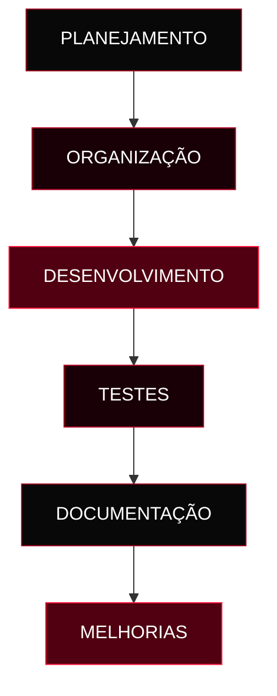

  

  

 

# SOBRE O PROJETO

O **Projeto Oficina** é um projeto voltado ao contexto automotivo, reunindo materiais, arquivos e soluções desenvolvidas durante sua construção.

O objetivo deste repositório é organizar o desenvolvimento e documentar a evolução do projeto.

 

 

# OBJETIVOS

 

 

Organizar os arquivos e materiais do projeto.

  

 

Aplicar conhecimentos técnicos na construção da solução.

  

 

Registrar as informações e funcionalidades implementadas.

  

 

Acompanhar melhorias e atualizações do projeto.

 

 

# TECNOLOGIAS

 

  

Ferramentas ilustrativas. Mantenha apenas as tecnologias realmente utilizadas.

 

 

# FLUXO DO PROJETO

 

<strong>VER CHECKLIST DO PROJETO</strong>

 

- [ ] Organizar os arquivos.
- [ ] Confirmar as tecnologias utilizadas.
- [ ] Documentar as funcionalidades.
- [ ] Registrar instruções de execução.
- [ ] Atualizar a documentação.

 

 

# AUTORIA

 

## ANDRESSA PAPINI

DESENVOLVIMENTO · ORGANIZAÇÃO · DOCUMENTAÇÃO

  

  

PRETO ABSOLUTO · VERMELHO INTENSO · DESIGN AUTOMOTIVO

